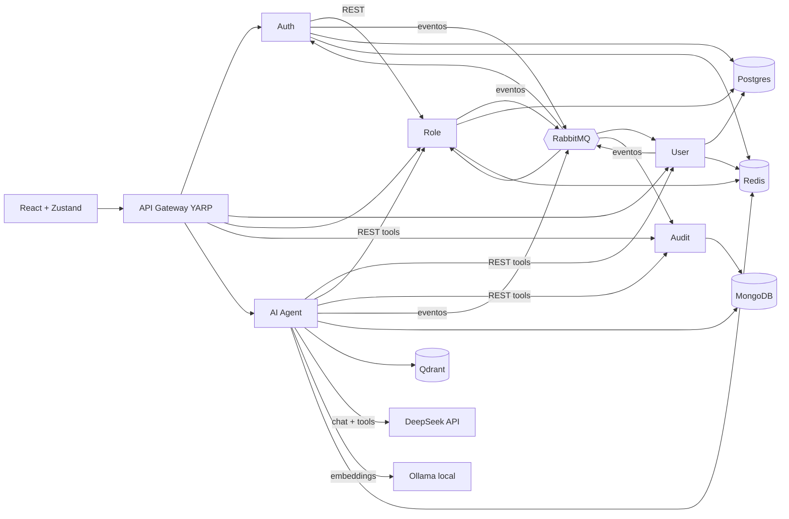

# Toka · Sistema de Gestión de Usuarios con Microservicios y Agente de IA

Solución a la prueba técnica **Senior Full-Stack Engineer (IA)**: autenticación, autorización, auditoría de accesos y gestión de roles sobre **5 microservicios .NET 8 + API Gateway**, un **front-end React + TypeScript**, y un **agente de IA con RAG** que usa **DeepSeek** (API compatible con OpenAI). Todo corre con **Docker Compose** en Docker Desktop para Windows.



---

## Entregables

Organizados según la sección *Entregables Esperados* del requerimiento. Cada carpeta tiene un README con enlaces directos al código.

### 1. Arquitectura → [`docs/01-arquitectura`](docs/01-arquitectura/README.md)

| Entregable | Enlace |
|---|---|
| Diagramas de arquitectura y justificación técnica | [GuiaDeArquitectura.md](docs/01-arquitectura/GuiaDeArquitectura.md) |
| Diseño de `docker-compose.yml` | [GuiaDeArquitectura §11](docs/01-arquitectura/GuiaDeArquitectura.md#11-diseño-de-docker-composeyml-estructura) · [docker-compose.yml](docker-compose.yml) |
| Aplicación de DDD y Clean Architecture | [GuiaDeArquitectura §7](docs/01-arquitectura/GuiaDeArquitectura.md#7-ddd-y-clean-architecture) |

### 2. Microservicios → [`docs/02-microservicios`](docs/02-microservicios/README.md)

| Entregable | Enlace |
|---|---|
| Código fuente de los microservicios | [`src/Services`](src/Services) (Auth · User · Roles · Audit · Ai) · [`src/Gateway`](src/Gateway) · [`src/BuildingBlocks`](src/BuildingBlocks) |
| Dockerfiles por microservicio | [Tabla de Dockerfiles](docs/02-microservicios/README.md#código-fuente) |
| `docker-compose.yml` funcional completo | [docker-compose.yml](docker-compose.yml) + variantes [ollama-native](docker-compose.ollama-native.yml), [openai-embeddings](docker-compose.openai-embeddings.yml), [tests](docker-compose.tests.yml) |
| Tests unitarios con coverage report | [`tests/`](tests) · [reporte de cobertura](docs/02-microservicios/coverage/README.md) |
| Documentación de ejecución del sistema | [GuiaPasoAPaso.md](docs/guias/GuiaPasoAPaso.md) · [GuiaDelImplementador.md](docs/guias/GuiaDelImplementador.md) |

### 3. Front-end → [`docs/03-frontend`](docs/03-frontend/README.md)

| Entregable | Enlace |
|---|---|
| Código fuente de la aplicación | [`frontend/src`](frontend/src) |
| Configuración de state management | [`frontend/src/stores`](frontend/src/stores) (Zustand) |
| Tests de componentes | [`frontend/src/__tests__`](frontend/src/__tests__) · [resumen de cobertura](docs/03-frontend/coverage-summary.txt) |

### 4. Análisis (diagnóstico) → [`docs/04-diagnostico`](docs/04-diagnostico/README.md)

| Entregable | Enlace |
|---|---|
| Respuesta del ejercicio de diagnóstico | [Ejercicio4-Diagnostico.md](docs/04-diagnostico/Ejercicio4-Diagnostico.md) |

### 5. IA y Agentes → [`docs/05-ia-agentes`](docs/05-ia-agentes/README.md)

| Entregable | Enlace |
|---|---|
| Código del microservicio de IA | [`src/Services/Ai`](src/Services/Ai) |
| Pipeline de embeddings | [`IngestKnowledgeUseCase.cs`](src/Services/Ai/Toka.Ai.Application/UseCases/IngestKnowledgeUseCase.cs) · [`TextChunker.cs`](src/Services/Ai/Toka.Ai.Application/Rag/TextChunker.cs) · [`QdrantVectorStore.cs`](src/Services/Ai/Toka.Ai.Infrastructure/VectorStore/QdrantVectorStore.cs) |
| Estrategia de prompt engineering | [PromptEngineering.md](docs/05-ia-agentes/PromptEngineering.md) |
| Código de evaluación de respuestas (latencia, costos, calidad) | [`ResponseValidator.cs`](src/Services/Ai/Toka.Ai.Application/Evaluation/ResponseValidator.cs) · [`MetricsSummary.cs`](src/Services/Ai/Toka.Ai.Application/Evaluation/MetricsSummary.cs) · [`EvaluateAgentUseCase.cs`](src/Services/Ai/Toka.Ai.Application/UseCases/EvaluateAgentUseCase.cs) |

### Documentación transversal

| Documento | Para qué |
|---|---|
| [GuiaPasoAPaso.md](docs/guias/GuiaPasoAPaso.md) | **Validar el circuito completo** en Docker Desktop (Windows), fase por fase con checkpoints |
| [GuiaDelImplementador.md](docs/guias/GuiaDelImplementador.md) | Estructura del código, convenciones, cómo extender, configuración y troubleshooting |
| [Sugerencias.md](docs/Sugerencias.md) | Observaciones sobre el requerimiento, riesgos (privacidad con DeepSeek, .NET 8 EOL, ROPC…) y mejoras |

---

## Inicio rápido

```powershell
cd C:\dev\toka-user-management
Copy-Item .env.example .env          # y pon tu LLM_API_KEY de DeepSeek
powershell -ExecutionPolicy Bypass -File .\scripts\run-tests.ps1     # compila + tests + cobertura
docker compose up -d --build
powershell -ExecutionPolicy Bypass -File .\scripts\smoke-test.ps1    # prueba end-to-end
```

UI: **http://localhost:3000** → `admin@toka.local` / `Admin123!`. Guía completa: [GuiaPasoAPaso.md](docs/guias/GuiaPasoAPaso.md).

## Servicios y puertos

| Servicio | Puerto | Tecnología | Datos |
|---|---|---|---|
| frontend | 3000 | React 18 + TS + Zustand (nginx) | — |
| api-gateway | 5000 | YARP | — |
| auth-service | 5001 | .NET 8 · JWT RS256 · OIDC/JWKS | Postgres `auth_db`, Redis |
| user-service | 5002 | .NET 8 · EF Core | Postgres `users_db`, Redis |
| role-service | 5003 | .NET 8 · EF Core | Postgres `roles_db`, Redis |
| audit-service | 5004 | .NET 8 · MongoDB.Driver | MongoDB `audit_db` |
| ai-service | 5005 | .NET 8 · DeepSeek (OpenAI-compatible) · Qdrant | Qdrant, MongoDB `ai_db`, Redis |
| RabbitMQ UI · Seq · Qdrant UI | 15672 · 5341 · 6333 | Mensajería · logs centralizados · vectores | — |

## Configuración de IA

| Variable (`.env`) | Default | Notas |
|---|---|---|
| `LLM_BASE_URL` | `https://api.deepseek.com` | Cualquier API compatible con OpenAI |
| `LLM_API_KEY` | — (**obligatoria**) | Nunca se sube: `.env` está en `.gitignore` |
| `CHAT_MODEL` | `deepseek-flash` | o `deepseek-v4-pro`; con OpenAI, p. ej. `gpt-4o-mini` |
| `EMBEDDINGS_BASE_URL` / `EMBEDDING_MODEL` | Ollama local / `nomic-embed-text` | DeepSeek no ofrece embeddings |
| `PRICE_*` | Tarifa pico de `deepseek-flash` | Para el cálculo de costo por consulta |

## Estructura del repositorio

```
docs/01-arquitectura … 05-ia-agentes   Entregables por ejercicio (cada uno con README índice)
docs/guias                             Guía paso a paso y guía del implementador
src/BuildingBlocks                     Contratos y piezas transversales (logging, JWT, RabbitMQ, Redis)
src/Services/*                         Auth · User · Roles · Audit · Ai  (Domain / Application / Infrastructure / Api)
src/Gateway                            API Gateway (YARP)
tests/                                 Tests unitarios xUnit + Dockerfile de cobertura
frontend/                              React + TypeScript + Zustand + Jest
knowledge/                             Base de conocimiento del RAG + dataset de evaluación
scripts/                               run-tests.ps1 · smoke-test.ps1
```

## Estado de verificación

- ✅ Front-end: `tsc` sin errores, **39/39 tests**, ~74 % de líneas, build de producción OK.
- ✅ Los 4 archivos de Docker Compose validan con `docker compose config`.
- ✅ Datos de la API de DeepSeek (URL, modelos, *thinking* activo por defecto, campos de uso de caché, precios) verificados contra su documentación oficial.
- ⚠️ Backend .NET: escrito sin acceso a SDK/NuGet en el entorno de generación; **su primera compilación ocurre en la fase 2 de la [GuiaPasoAPaso](docs/guias/GuiaPasoAPaso.md)** (ver [Sugerencias D1](docs/Sugerencias.md)).
