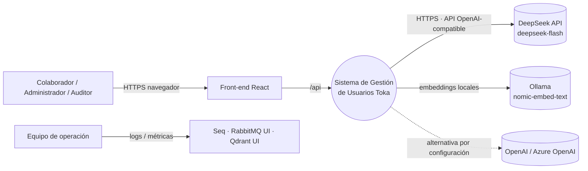
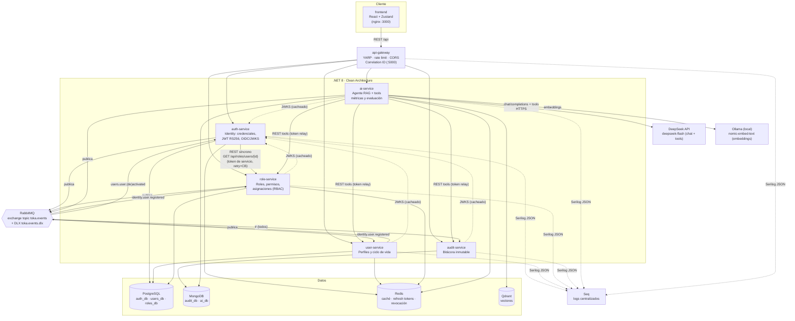
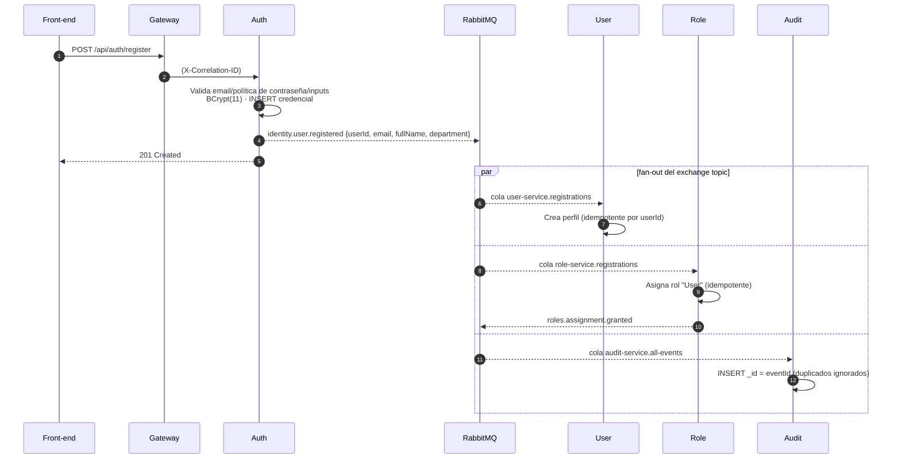
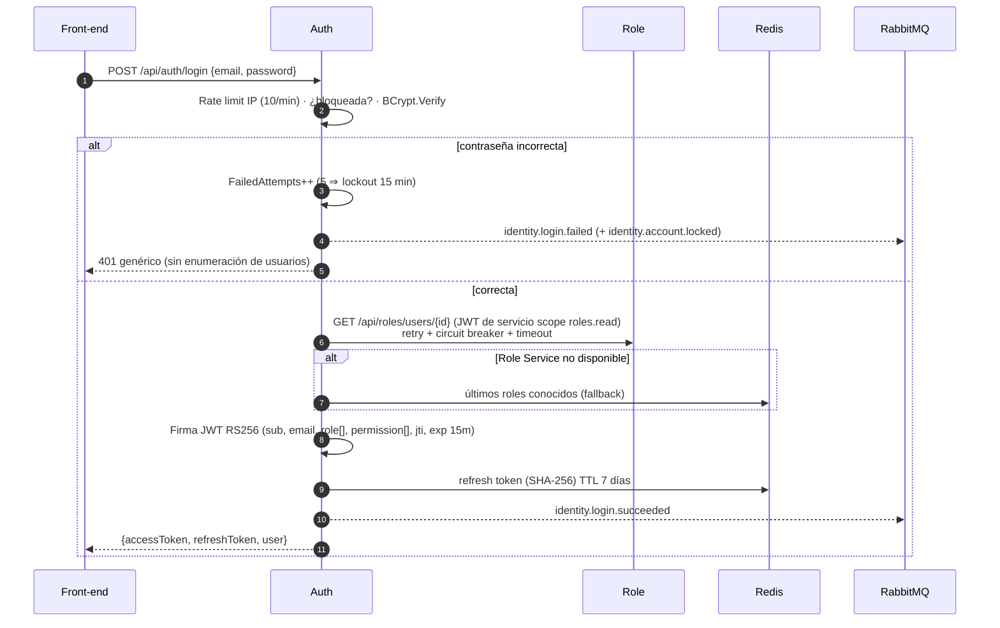
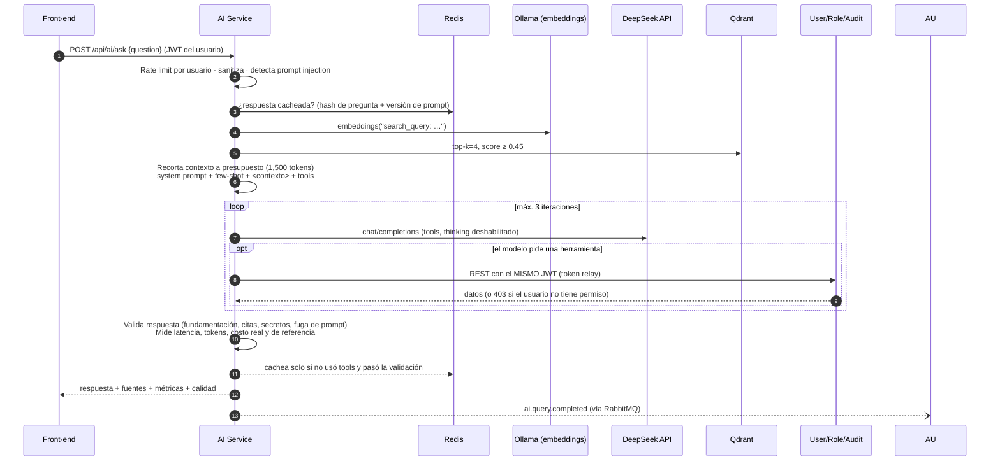
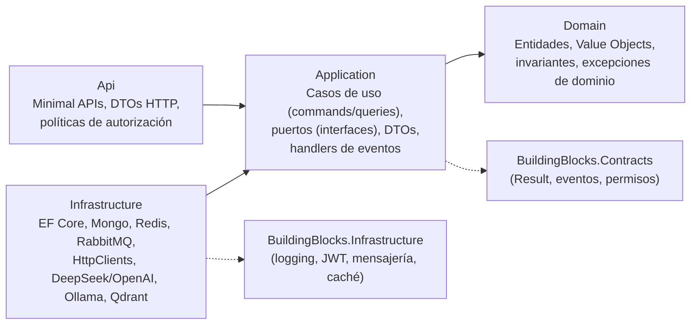

# Guía de Arquitectura — Sistema de Gestión de Usuarios con Microservicios e IA

> **Ejercicio 1 · Diseño y Arquitectura de Software.** Este documento describe el *qué* y el *por qué* de la solución. El *cómo* (código, convenciones, extensión) está en [GuiaDelImplementador.md](../guias/GuiaDelImplementador.md) y la forma de probarlo en [GuiaPasoAPaso.md](../guias/GuiaPasoAPaso.md).

| Dato | Valor |
|---|---|
| Stack backend | C# / .NET 8 (ASP.NET Core Minimal APIs), EF Core 8, MongoDB.Driver, RabbitMQ.Client, YARP |
| Front-end | React 18 + TypeScript + Zustand + Vite, servido por nginx |
| Datos | PostgreSQL 16 (transaccional) · MongoDB 7 (auditoría y métricas IA) · Redis 7 (caché, sesiones) · Qdrant (vectores) |
| Mensajería | RabbitMQ 3.13 (exchange *topic* + DLQ) |
| IA | **DeepSeek** (`deepseek-flash`, chat + function calling) vía API compatible con OpenAI · embeddings `nomic-embed-text` locales (Ollama) · Qdrant |
| Observabilidad | Serilog JSON (CLEF) → consola + Seq (logs centralizados), Correlation ID extremo a extremo |
| Ejecución | Docker Compose (probado para Docker Desktop en Windows con WSL2) |

---

## 1. Contexto y objetivos

El sistema debe ofrecer **autenticación, autorización, auditoría de accesos y gestión de roles**, ser **escalable**, estar basado en **microservicios**, ejecutarse **localmente con Docker** e integrar un **agente de IA con RAG**.

Atributos de calidad priorizados (en este orden):

1. **Seguridad** — es un sistema de identidad; un error aquí compromete todo lo demás.
2. **Disponibilidad/resiliencia** — un servicio caído no debe tumbar el login ni la consulta de perfiles.
3. **Auditabilidad** — todo cambio relevante queda registrado de forma inmutable.
4. **Evolutividad** — cada bounded context puede cambiar, desplegarse y escalar por separado.
5. **Costo controlado de IA** — latencia, tokens (incluidos los servidos desde la caché del proveedor) y costo en USD medidos por consulta; caché de respuestas y límites por usuario.

---

## 2. Vista de contexto



---

## 3. Vista de contenedores (microservicios e interacciones)



### 3.1 Responsabilidades (bounded contexts)

| Servicio | Bounded context | Responsabilidad | Persistencia | Publica | Consume |
|---|---|---|---|---|---|
| **auth-service** | Identity & Access | Registro de credenciales, login, refresh, logout, OAuth2 `token` endpoint (`password`, `refresh_token`, `client_credentials`), discovery OIDC y JWKS, bloqueo por intentos | Postgres `auth_db` (credenciales), Redis (refresh tokens hasheados, lista de revocación, últimos roles conocidos) | `identity.*` | `users.user.deactivated/activated` |
| **user-service** | Users | Perfil (nombre, departamento, puesto), estado activo/desactivado, búsqueda, estadísticas | Postgres `users_db`, Redis (cache-aside de perfiles) | `users.*` | `identity.user.registered` |
| **role-service** | Authorization | Roles, permisos `recurso:acción`, asignaciones, permisos efectivos, invariante "siempre un admin" | Postgres `roles_db` (permisos como `text[]`), Redis (permisos efectivos) | `roles.*` | `identity.user.registered` |
| **audit-service** | Audit | Registro inmutable e idempotente de **todos** los eventos; búsqueda y resumen | MongoDB `audit_db` (índices + TTL de retención) | — | `#` (todo) |
| **ai-service** | AI Assistant | RAG sobre políticas/manuales, agente con herramientas sobre los microservicios, métricas de latencia/tokens/costo, validación de calidad, evaluación con dataset | Qdrant (embeddings), MongoDB `ai_db` (métricas), Redis (caché de respuestas) | `ai.*` | — |
| **api-gateway** | — (borde) | Punto de entrada único (BFF ligero), enrutamiento, rate limiting global, CORS, Correlation ID | — | — | — |

> **Separación Identity vs Users.** La credencial (hash de contraseña, bloqueo) y el perfil (datos de negocio) son modelos distintos con ciclos de cambio y requisitos de seguridad distintos. Separarlos reduce la superficie de ataque: User Service **nunca** ve un hash de contraseña, y el agente de IA no tiene ruta alguna hacia Auth Service.

---

## 4. Flujos de datos entre microservicios

### 4.1 Registro (asíncrono, consistencia eventual)



### 4.2 Login (síncrono REST + emisión de JWT)



### 4.3 Petición autenticada (validación distribuida)

Cada servicio valida el JWT **localmente**: descarga una vez el documento `/.well-known/openid-configuration` y el JWKS de Auth Service (se cachean y se refrescan ante un `kid` desconocido → soporta rotación de claves). Valida firma RS256, `iss`, `aud`, `exp` y consulta en Redis si el `jti` fue revocado (logout). **No hay llamada a Auth por petición**, por lo que Auth no es cuello de botella ni punto único de fallo para el tráfico normal.

### 4.4 Consulta al agente de IA (RAG + tools)



---

## 5. Comunicación entre microservicios

| Tipo | Dónde | Por qué |
|---|---|---|
| **Síncrona REST** | Gateway → servicios; Auth → Role (roles al emitir token); AI → User/Role/Audit (tools) | Cuando el llamador **necesita la respuesta para continuar** (no se puede emitir un token sin permisos). |
| **Asíncrona (RabbitMQ)** | Registro → perfil + rol por defecto; cambios de estado → Auth; todo → Audit | Cuando el productor **no necesita esperar**: desacopla disponibilidad, permite fan-out sin que el productor conozca a los consumidores y absorbe picos. |

**Decisiones de mensajería**

- **Exchange `topic` único** (`toka.events`) con routing keys `{contexto}.{agregado}.{hecho}`. Audit se suscribe con `#`; los demás con claves concretas. Agregar un consumidor no requiere tocar al productor (Open/Closed a nivel de sistema).
- **Envelope homogéneo** (`IntegrationEvent`: id, tipo, fecha, actor, sujeto, IP, correlationId, éxito, `data`). Audit persiste cualquier evento sin conocer su esquema; los consumidores toleran campos nuevos.
- **Entrega at-least-once**: mensajes persistentes, *publisher confirms*, ACK manual. Por eso **todos los handlers son idempotentes** (perfil por `userId`, rol por par usuario-rol, auditoría por `_id = eventId`).
- **Dead Letter Queue por cola** (`{cola}.dlq` vía `toka.events.dlx`): un mensaje envenenado no bloquea la cola ni se pierde.
- **RabbitMQ vs Kafka**: RabbitMQ porque el caso es *routing* de eventos de negocio con bajo volumen, se necesita DLQ/ACK por mensaje y su huella en Docker Desktop es mucho menor. Kafka se justificaría para *event sourcing*/streaming de alto volumen o re-procesamiento histórico (ver Sugerencias).

---

## 6. Estrategia de datos multi-DB (*database per service*)

| Almacén | Uso | Justificación |
|---|---|---|
| **PostgreSQL** | Credenciales, perfiles, roles/asignaciones | Datos transaccionales con invariantes (unicidad de email, FK rol-asignación). ACID, maduro, `text[]` nativo para permisos, gratuito y ligero en contenedor. Cada servicio tiene **su propia base** (`auth_db`, `users_db`, `roles_db`) y su propio esquema; ningún servicio lee la base de otro. |
| **MongoDB** | Auditoría, métricas de IA | Escritura append-only de alto volumen, documentos heterogéneos (`details` libre por tipo de evento), consultas por rango de fechas con índices compuestos y **TTL** para retención (365 días configurable). |
| **Redis** | Cache-aside de perfiles y permisos efectivos; refresh tokens (hash SHA-256, TTL); lista de revocación de `jti`; últimos roles conocidos (fallback); caché de respuestas del agente | Latencia sub-milisegundo y TTL nativo. Toda operación de caché es **tolerante a fallos** (si Redis cae, se va a la fuente de verdad). |
| **Qdrant** | Vectores de la base de conocimiento | Vector DB dedicada, búsqueda por coseno con filtros de payload, contenedor ligero, API REST simple. |

> **¿Por qué no SQL Server?** El requisito admite SQL Server/MySQL/Postgres. Se eligió Postgres por su menor consumo de memoria en Docker Desktop (SQL Server exige ≥2 GB solo para el motor) y compatibilidad con ARM. Cambiarlo es reemplazar el proveedor de EF Core (`UseNpgsql` → `UseSqlServer`) y el tipo de la columna de permisos (ver Sugerencias).

**Consistencia entre servicios.** No hay transacciones distribuidas. La consistencia es **eventual** y guiada por eventos; las ventanas son de milisegundos/segundos. Los casos donde se necesita consistencia fuerte (emitir un token con permisos vigentes) usan llamada síncrona con *fallback* explícito.

---

## 7. DDD y Clean Architecture

### 7.1 Capas por microservicio



- **La regla de dependencia apunta hacia adentro.** `Domain` no referencia nada; `Application` solo a `Domain` y a `Contracts` (abstracciones puras); `Infrastructure` implementa los puertos; `Api` compone todo (composition root).
- **Puertos y adaptadores.** `ICredentialRepository`, `IRoleServiceClient`, `IEventPublisher`, `ICacheService`, `ILlmClient`, `IVectorStore`, `IAgentToolExecutor`… se definen en Application y se implementan en Infrastructure. Por eso el agente de IA pasó de un modelo local (Ollama) a DeepSeek, y puede pasar a OpenAI, cambiando solo configuración, y los casos de uso se prueban sin bases de datos.
- **Result pattern** para errores de negocio esperados (validación, no encontrado, conflicto, prohibido, no disponible); excepciones solo para fallos técnicos. La Api traduce `ErrorType` → HTTP/ProblemDetails de forma uniforme.
- **CQRS ligero**: en User Service `UserQueries` (lectura con caché) y `UserCommands` (escritura + invalidación + evento) están separados. No se usó MediatR para no añadir indirección innecesaria en un sistema de este tamaño.

### 7.2 Modelo de dominio (agregados e invariantes)

| Agregado | Invariantes protegidas en el dominio |
|---|---|
| `UserCredential` (Auth) | Email normalizado válido (VO `EmailAddress`); política de contraseñas (`PasswordPolicy`); bloqueo tras N intentos; reactivar limpia el bloqueo. |
| `UserProfile` (Users) | Longitudes de nombre/departamento/puesto; transiciones de estado válidas (no desactivar dos veces). |
| `Role` (Roles) | Nombre con formato; permisos `recurso:acción` normalizados, sin duplicados, máx. 50; roles de sistema no eliminables. Regla de aplicación: siempre existe al menos un `Admin`. |
| `AuditEntry` (Audit) | Inmutable; id = id del evento (idempotencia); detalles sanitizados (claves con *password/secret/token* se enmascaran). |
| `QueryMetrics`, `ModelPricing`, `QualityReport` (AI) | Precios no negativos; cálculo de costo por millón de tokens; aprobación de calidad si score ≥ 0.6 y ningún check crítico falla. |

**Lenguaje ubicuo**: *credencial, perfil, rol, permiso, asignación, permisos efectivos, evento de auditoría, chunk, fuente, herramienta, presupuesto de contexto*.

---

## 8. Seguridad (OWASP / Zero Trust)

| Riesgo | Control implementado |
|---|---|
| A01 Broken Access Control | RBAC por **permisos** en el token; políticas por endpoint en *cada* servicio (no solo en el gateway); autorización a nivel de recurso (editar solo tu perfil); el agente usa **token relay** (nunca más privilegios que el usuario). |
| A02 Cryptographic Failures | JWT **RS256** (clave privada solo en Auth; el resto solo conoce la pública vía JWKS); BCrypt work factor 11; refresh tokens opacos de 256 bits guardados como SHA-256. |
| A03 Injection | EF Core/Mongo Driver parametrizados; `ILIKE` con escape de comodines; validación y sanitización de entrada (`TextInput`); defensa de **prompt injection** (contexto delimitado como datos, detección de patrones, validación de salida). |
| A04 Insecure Design | Mensaje de login genérico + tiempo homogéneo (anti enumeración); bloqueo por intentos; rate limiting por IP (auth), por usuario (IA) y global (gateway). |
| A05 Security Misconfiguration | ProblemDetails sin stack traces; cabeceras de seguridad (nosniff, DENY, CSP en nginx); contenedores **no-root**. |
| A07 Identification & Auth Failures | Access token corto (15 min), rotación de refresh token de un solo uso, revocación distribuida en logout, desactivación de cuenta propagada por evento. |
| A09 Logging & Monitoring | Auditoría de todos los eventos de seguridad (login fallido, bloqueo, cambios de rol); logs JSON con Correlation ID validado (anti log-injection); secretos nunca se registran. |

---

## 9. Escalabilidad y resiliencia

- **Servicios sin estado** (estado en Postgres/Mongo/Redis): escalan horizontalmente (`docker compose up --scale user-service=3`, o réplicas en Kubernetes). Las claves de firma se comparten vía volumen (en producción: Key Vault).
- **Competing consumers**: varias réplicas de un servicio comparten su cola de RabbitMQ y se reparten los mensajes.
- **HttpClient resiliente** (Microsoft.Extensions.Http.Resilience / Polly v8): *rate limiter → timeout total → retry exponencial con jitter (respeta `Retry-After` en 429) → circuit breaker → timeout por intento*.
- **Degradación elegante**: si Role Service cae, Auth usa los últimos roles conocidos en Redis; si Redis cae, las cachés se omiten; si el LLM cae, el agente responde 503 con mensaje claro y registra la métrica; las herramientas fallidas se reportan al modelo como `ERROR` en lugar de tumbar la respuesta.
- **Arranque robusto**: reintentos con backoff para crear esquemas, índices y conexión a RabbitMQ; *healthchecks* en Compose; indexación RAG en segundo plano mientras el servicio de embeddings descarga su modelo.
- **Health checks** `/health/live` (proceso) y `/health/ready` (dependencias).

---

## 10. Integración de IA en la arquitectura

- **Microservicio dedicado** (`ai-service`): aísla dependencias pesadas, permite escalar la inferencia de forma independiente y aplicar cuotas propias.
- **Protocolo OpenAI-compatible** con **dos endpoints independientes**: *chat* (`/chat/completions`, DeepSeek por defecto) y *embeddings* (`/embeddings`, Ollama local por defecto, porque DeepSeek no ofrece API de embeddings). Cada uno se configura con `BaseUrl`, `ApiKey` y `Model`; el mismo adaptador sirve para **OpenAI** o **Azure OpenAI** (ver `.env.example`).
- **Parámetros específicos del proveedor** sin acoplar el dominio: con DeepSeek el adaptador envía `{"thinking":{"type":"disabled"}}` (el modo de razonamiento viene activo por defecto y multiplica latencia y tokens).
- **RAG**: documentos Markdown en `knowledge/` → chunking por secciones con solapamiento → embeddings `nomic-embed-text` (768 dims, prefijos `search_document:`/`search_query:`) → Qdrant. Ids deterministas ⇒ re-indexar es idempotente.
- **Privacidad con un LLM externo**: al proveedor viajan la pregunta, los fragmentos de documentos recuperados y las salidas de herramientas **ya compactadas** (solo los campos necesarios; nunca hashes, tokens ni contraseñas, y el validador redacta secretos en la salida). La clasificación de datos y la residencia del proveedor deben aprobarse antes de producción (ver [Sugerencias](../Sugerencias.md), A1).
- **Agente con herramientas** sobre User/Role/Audit: los **datos personales no se vectorizan** (se consultan en vivo con los permisos del usuario), evitando fugas por el índice vectorial y datos obsoletos.
- **Evaluación**: latencia por etapa, tokens in/out/embeddings, tokens de entrada con *cache hit* del proveedor, **costo real en USD** (precios de DeepSeek configurables, con tarifa diferenciada para cache hit) y costo de referencia contra otro modelo, validación automática de calidad, y un endpoint de evaluación contra un *golden dataset* (`knowledge/eval/dataset.json`).

Detalle de prompts y evaluación: [PromptEngineering.md](../05-ia-agentes/PromptEngineering.md).

---

## 11. Diseño de `docker-compose.yml` (estructura)

```yaml
name: toka
x-dotnet-env: &dotnet-env          # variables comunes a los servicios .NET (Seq, Redis, RabbitMQ, JWT)
services:
  # Infraestructura (con healthchecks)
  postgres:   { image: postgres:16-alpine }        # auth_db, users_db, roles_db (creadas por cada servicio)
  mongo:      { image: mongo:7 }                   # audit_db, ai_db
  redis:      { image: redis:7-alpine }
  rabbitmq:   { image: rabbitmq:3.13-management }  # UI :15672
  qdrant:     { image: qdrant/qdrant:v1.12.4 }     # UI :6333/dashboard
  ollama:     { image: ollama/ollama }             # SOLO embeddings del RAG (DeepSeek no ofrece embeddings)
  ollama-init:{ image: ollama/ollama }             # pull de nomic-embed-text (una vez)
  seq:        { image: datalust/seq }              # logs centralizados :5341
  # Microservicios (.NET 8, build multi-stage, usuario no-root)
  auth-service:  { build: src/Services/Auth/Dockerfile,  depends_on: [postgres, redis, rabbitmq] }
  user-service:  { build: src/Services/User/Dockerfile,  depends_on: [postgres, redis, rabbitmq] }
  role-service:  { build: src/Services/Roles/Dockerfile, depends_on: [postgres, redis, rabbitmq] }
  audit-service: { build: src/Services/Audit/Dockerfile, depends_on: [mongo, rabbitmq] }
  ai-service:    { build: src/Services/Ai/Dockerfile,    depends_on: [qdrant, mongo, ollama-init],
                   environment: { Llm__Chat__BaseUrl: https://api.deepseek.com, Llm__Chat__ApiKey: ${LLM_API_KEY} } }
  api-gateway:   { build: src/Gateway/Dockerfile,        ports: ["5000:8080"] }
  frontend:      { build: ./frontend,                    ports: ["3000:8080"] }
networks: { toka: {} }
volumes: { postgres-data, mongo-data, redis-data, rabbitmq-data, qdrant-data, ollama-models, seq-data, auth-keys }
```

Variantes: `docker-compose.openai-embeddings.yml` (embeddings con OpenAI, sin Ollama), `docker-compose.ollama-native.yml` (embeddings con Ollama instalado en Windows), `docker-compose.tests.yml` (tests + cobertura en contenedor). Archivo real: [docker-compose.yml](../../docker-compose.yml).

---

## 12. Registro de decisiones (ADR resumidos)

| # | Decisión | Alternativas | Motivo |
|---|---|---|---|
| ADR-01 | .NET 8 + Minimal APIs | Controllers MVC, NestJS, FastAPI | Requisito permite C#; Minimal APIs reducen ceremonia y siguen siendo testeables vía casos de uso. |
| ADR-02 | JWT RS256 + JWKS propio | HS256 compartido, Keycloak, Duende | Validación distribuida sin compartir secretos; sin dependencias pesadas para el entorno local. En producción: IdP gestionado (ver Sugerencias). |
| ADR-03 | RabbitMQ topic + DLQ | Kafka, Azure Service Bus | Routing y ACK por mensaje con baja huella local. |
| ADR-04 | Postgres por servicio (bases separadas, una instancia) | SQL Server, instancia por servicio | Menor consumo en Docker Desktop manteniendo aislamiento lógico. |
| ADR-05 | Auditoría como consumidor pasivo de `#` | Llamadas REST a Audit desde cada servicio | Cero acoplamiento: los servicios no saben que se les audita; la auditoría no puede tumbar a nadie. |
| ADR-06 | Adaptador propio OpenAI-compatible; chat con DeepSeek, embeddings locales | SDK de OpenAI, Semantic Kernel, LangChain | Un único adaptador para DeepSeek/OpenAI/Azure/Ollama; sin dependencias extra; control total de métricas (tokens con cache hit, costo). DeepSeek por costo por token bajo y soporte de tools; embeddings locales porque DeepSeek no los ofrece y así los documentos no salen para vectorizarse. |
| ADR-07 | Datos personales vía tools, no en el vector store | Vectorizar perfiles | Privacidad, autorización por usuario y frescura de datos. |
| ADR-08 | YARP como gateway/BFF | Ocelot, nginx-only, Kong | Nativo .NET, configurable por JSON, extensible en C#. |
