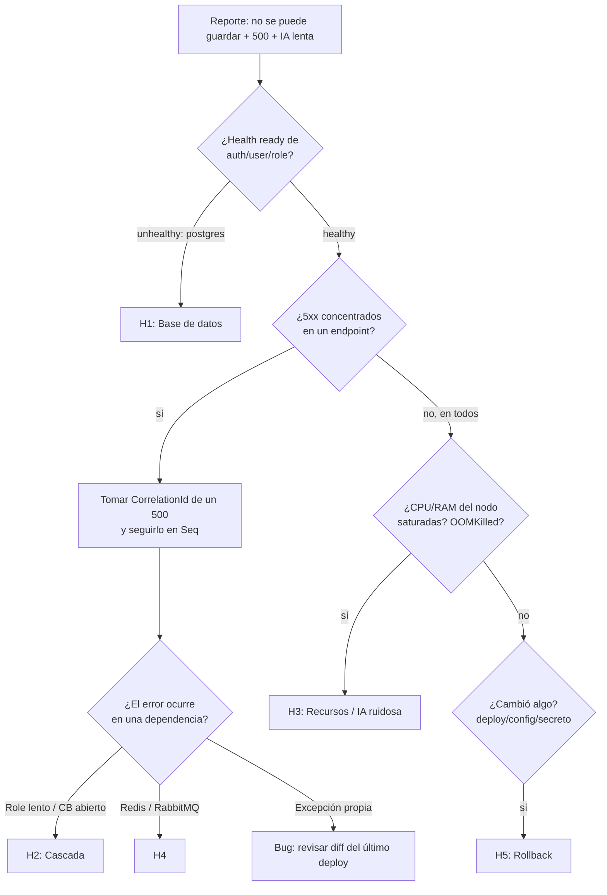

# Ejercicio 4 · Desempeño bajo presión — Diagnóstico de incidente en producción

> **Incidente:** "Los usuarios no pueden guardar registros, algunos microservicios responden con errores 500, y hay reportes de alta latencia en las respuestas de agentes de IA."

El análisis usa las herramientas reales de esta solución (logs JSON en Seq con `CorrelationId`, health checks, RabbitMQ UI, métricas del agente en MongoDB, `docker stats`) y su equivalente en producción (Kubernetes, Azure Monitor/Datadog, etc.).

---

## 1. Primeros 5 minutos: estabilizar y acotar

1. **Declarar el incidente** (severidad SEV-2: funcionalidad core degradada; SEV-1 si el login también falla). Nombrar *Incident Commander* (coordina y comunica) y *Ops lead* (diagnostica). Abrir canal `#inc-usuarios-AAAAMMDD`.
2. **Congelar despliegues** y preguntar: *¿qué cambió?* (último deploy, cambio de configuración, rotación de secretos, migración de base de datos, cambio de modelo/prompt de IA, pico de tráfico, campaña).
3. **Medir el radio de impacto** con datos, no con reportes:
   - Tasa de 5xx por servicio y endpoint (últimos 30 min vs. línea base).
   - ¿Afecta a todos los usuarios o a un tenant/rol/región?
   - ¿Lecturas funcionan y solo fallan escrituras? → apunta fuertemente a la capa de datos.
4. **Mitigar antes de entender** si hay una palanca segura: *rollback* del último deploy, desactivar herramientas del agente (`Agent__ToolsEnabled=false`), bajar `MaxToolIterations`, activar caché, escalar réplicas.

---

## 2. Hipótesis priorizadas

La priorización combina **probabilidad** (dado el síntoma "no se puede guardar" + 500 en *varios* servicios) × **impacto** × **costo de verificar**. Un síntoma que cruza varios servicios casi siempre es una **dependencia compartida**, no un bug en cada servicio.

| # | Hipótesis | Por qué encaja | Verificación rápida (≤ 2 min) |
|---|---|---|---|
| H1 | **Base de datos transaccional (Postgres) degradada**: pool de conexiones agotado, disco lleno, bloqueos/deadlocks, réplica primaria caída, failover en curso | Explica "no se puede guardar" + 500 en Auth, User y Role a la vez (comparten instancia) | `/health/ready` de cada servicio (incluye el check de EF Core) · logs `Npgsql`/`EnableRetryOnFailure` · `pg_stat_activity` (conexiones, `wait_event`), espacio en disco |
| H2 | **Fallo en cascada por llamada síncrona**: Role Service lento → Auth agota hilos esperando → timeouts → 500/503 | Login y operaciones dependientes fallan juntas | Seq: `RequestPath like '/api/roles/users%' and Elapsed > 2000`; eventos de circuit breaker abierto; latencia p99 de Role |
| H3 | **Recursos compartidos de nodo saturados por la IA**: modelos locales (embeddings u otro modelo autohospedado) consumen CPU/RAM del mismo host/nodo → todos los servicios se vuelven lentos y los timeouts disparan 500 | Une los dos síntomas (latencia IA + errores en otros servicios) | `docker stats` / métricas del nodo (CPU steal, OOMKilled, memoria) · reinicios recientes de pods |
| H4 | **Redis o RabbitMQ caídos/lentos** | Redis: debería degradar, no fallar (caché tolerante). RabbitMQ: la publicación tiene try/catch; pero conexiones colgadas pueden bloquear | `redis-cli ping`/latencia; RabbitMQ UI: conexiones bloqueadas por *memory/disk alarm*, colas creciendo, DLQ con mensajes |
| H5 | **Error de despliegue/configuración** (cadena de conexión, secreto rotado, migración incompatible, clave JWKS cambiada) | Encaja si empezó justo tras un cambio | Correlacionar hora de inicio con el historial de despliegues; logs de arranque; 401 masivos ⇒ clave de firma |
| H6 | **Proveedor LLM: rate limiting / cuota / latencia** (DeepSeek/OpenAI: 429 y `Retry-After`, 402 sin saldo, degradación del proveedor; también la cola local de concurrencia saturada) | Explica la latencia de IA; con reintentos agresivos puede amplificar carga | Métricas del agente: `LlmLatencyMs`, `Error = LlmRateLimitedException`, `LlmCalls` por consulta; logs "Cola de inferencia saturada" |
| H7 | **Costo/tokens disparados**: prompt más largo tras un cambio, contexto RAG sin recorte, bucles de herramientas, caché desactivada | Latencia ∝ tokens; costo ∝ tokens | `avgTokensPerQuery`, `PromptTokens` p95, `LlmCalls`, `cacheHitRate` antes/después; `PromptVersion` nueva en métricas |
| H8 | **Red / DNS / service discovery** entre contenedores | 502/504 intermitentes | `HttpRequestException` en logs, resolución DNS, errores de TLS |

**Orden de ataque:** H1 → H3 → H2 → H5 → H4 → H6/H7 → H8. H1 primero porque es la causa más frecuente de "no se puede guardar" en varios servicios a la vez y se descarta en un minuto con los health checks.

---

## 3. Plan de diagnóstico sistemático con logs estructurados

### 3.1 Del síntoma a la causa (de afuera hacia adentro)



### 3.2 Consultas concretas en el log centralizado (Seq / KQL / Datadog)

Todos los servicios emiten JSON con `service`, `CorrelationId`, `RequestPath`, `StatusCode`, `Elapsed`, `UserId`. Eso permite pasar de "algo falla" a "esta petición falló aquí" en minutos:

```text
-- 1) ¿Dónde están los 500 y desde cuándo? (agrupar por servicio y ruta)
select count(*) from stream where StatusCode >= 500 group by service, RequestPath, time(1m)

-- 2) Seguir una petición fallida de punta a punta
CorrelationId = '<id copiado de la respuesta ProblemDetails o del banner de la UI>'

-- 3) Excepciones de base de datos
@Exception like '%Npgsql%' or @Exception like '%timeout%' or @Exception like '%too many clients%'

-- 4) Fallos en cascada / resiliencia
@Message like '%circuit%' or @Message like '%Role Service no disponible%' or StatusCode in (502, 503, 504)

-- 5) Mensajería
@Message like 'No se pudo publicar el evento%' or @Message like 'Error procesando mensaje%'

-- 6) Agente de IA
@MessageTemplate like 'Consulta IA%' and LatencyMs > 20000
@Message like '%Cola de inferencia saturada%' or @Message like '%429%'
```

Los mensajes de error que ve el usuario (banner del front, ProblemDetails) incluyen **Correlation ID**: soporte lo pide y el ingeniero salta directo a la traza.

### 3.3 Herramientas de debugging por capa

| Capa | Herramienta | Qué buscar |
|---|---|---|
| Contenedores | `docker compose ps`, `docker stats`, `docker compose logs --since 15m <svc>` · K8s: `kubectl top`, `describe pod`, eventos | Reinicios, OOMKilled, CPU al 100 % |
| Servicios | `/health/live`, `/health/ready` | Qué dependencia reporta *Unhealthy* |
| Postgres | `pg_stat_activity`, `pg_locks`, espacio en disco, logs del servidor | Conexiones al máximo, transacciones largas, bloqueos |
| RabbitMQ | UI: conexiones, alarmas, profundidad de colas, `*.dlq` | *Memory alarm* bloquea publishers; colas que crecen = consumidor caído |
| Redis | `redis-cli --latency`, `INFO memory` | Evicciones, latencia |
| IA | `GET /api/ai/metrics/summary`, `GET /api/ai/metrics/recent`, colección `ai_db.query_metrics` | p95, tokens/consulta, `LlmCalls`, `Error`, `PromptVersion`, `CacheHit` |
| Red | `docker compose exec <svc> getent hosts <otro>` | DNS / resolución |

**Recomendación:** añadir **trazas distribuidas OpenTelemetry** (ver Sugerencias) para ver en un solo *waterfall* gateway → auth → role → postgres con tiempos por tramo.

---

## 4. Problemas específicos de los agentes de IA

### 4.1 Alta latencia

Descomponer la latencia con las métricas que ya registra el agente (`RetrievalLatencyMs`, `LlmLatencyMs`, `ToolLatencyMs`, `LlmCalls`):

| Si domina… | Causa típica | Acción |
|---|---|---|
| `LlmLatencyMs` con `LlmCalls = 1` | Prompt muy largo, modelo grande, CPU saturada, *cold start* del modelo | Reducir `MaxContextTokens`/`TopK`, modelo más pequeño, GPU, `OLLAMA_KEEP_ALIVE`, *streaming* para mejorar la latencia percibida |
| `LlmCalls ≥ 3` | Bucle de herramientas | Bajar `MaxToolIterations`, mejorar descripciones de tools, prompt más directivo |
| `ToolLatencyMs` | Un microservicio de datos está lento (¡conecta con H1/H2!) | Diagnosticar ese servicio; timeouts más agresivos para tools |
| `RetrievalLatencyMs` | Embeddings o Qdrant lentos | Revisar Qdrant, cachear embeddings de preguntas frecuentes |
| Espera antes de empezar | Cola de concurrencia (`MaxConcurrency`) llena | Escalar réplicas de inferencia, aumentar paralelismo si hay GPU, *rate limit* por usuario |

### 4.2 Costos elevados de tokens

- Revisar `avgTokensPerQuery`, `TotalReferenceCostUsd` y su evolución por `PromptVersion`. Un salto tras un deploy suele ser un prompt o un few-shot más largo.
- Palancas: presupuesto de contexto (`MaxContextTokens`), `TopK`, compactar salidas de herramientas (ya se hace), `MaxAnswerTokens`, **caché** de respuestas documentales (verificar `cacheHitRate`), *routing* a modelo barato para preguntas simples, *prompt caching* del proveedor.
- Guardarraíles: límite por usuario/minuto (ya existe), presupuesto diario por usuario/área, alerta cuando el costo por hora supera el umbral.

### 4.3 Rate limiting de APIs de IA (proveedor en nube)

- Síntoma: 429 con `Retry-After`; métricas con `Error = LlmRateLimitedException`.
- El cliente ya reintenta con backoff exponencial + jitter respetando `Retry-After`, y el circuit breaker corta cuando el proveedor está caído para no amplificar la carga. **Riesgo:** reintentos de muchos clientes = tormenta; vigilar que el volumen de reintentos no duplique el tráfico.
- Acciones: limitar concurrencia (`MaxConcurrency`), solicitar aumento de cuota TPM/RPM, distribuir entre despliegues/regiones (Azure OpenAI), degradar con mensaje claro y respuesta en caché.

### 4.4 Contención: que la IA no tumbe lo demás

- **Bulkhead**: el agente vive en su propio servicio y con concurrencia limitada; en producción, en su **propio node pool** (GPU) para que la inferencia no robe CPU a Auth/User/Role (H3).
- **Kill switch**: `Agent__ToolsEnabled=false` o escalar `ai-service` a 0 sin afectar la gestión de usuarios.

---

## 5. Línea de tiempo de ejemplo (cómo se resolvería)

| T | Acción | Hallazgo |
|---|---|---|
| T+0 | Alerta de 5xx > 5 % en auth/user/role; IC asignado; canal abierto | — |
| T+3 | `/health/ready` de user-service → `postgres: Unhealthy` | Confirma H1 como principal |
| T+6 | `pg_stat_activity`: 100/100 conexiones, la mayoría abiertas por las réplicas nuevas de `user-service` | Pool agotado tras escalar user-service de 3 a 12 réplicas (12 réplicas × pool por defecto > `max_connections`) |
| T+8 | **Mitigación**: volver a 3 réplicas; 5xx bajan a 0 % | Servicio restablecido |
| T+15 | Latencia IA sigue alta: métricas muestran `ToolLatencyMs` alto (tools esperaban a user-service) y `LlmLatencyMs` normal | La latencia de IA era **síntoma** de H1, no causa propia |
| T+30 | Ajustes: `Maximum Pool Size` por réplica, PgBouncer, alerta de conexiones al 80 % | — |
| T+2d | Postmortem sin culpables con acciones y responsables | — |

---

## 6. Comunicación a stakeholders

**Principios:** cadencia fija (cada 30 min aunque no haya novedades), lenguaje de impacto para negocio y detalle técnico separado, sin especular causas no confirmadas, un único canal oficial.

| Audiencia | Canal | Contenido |
|---|---|---|
| Equipo técnico | Canal del incidente | Hipótesis, evidencias, quién hace qué, decisiones |
| Negocio / soporte / dirección | Correo o canal de estado | Impacto, mitigación, ETA de próxima actualización |
| Usuarios finales | Banner en la app / página de estado | Qué no funciona, alternativa, cuándo se actualizará |

**Plantilla de actualización (negocio):**

> **[SEV-2] Gestión de usuarios degradada — Actualización #2 (10:45)**
> **Impacto:** desde las 10:05, ~40 % de los intentos de guardar perfiles y asignar roles fallan; el asistente de IA responde lento. El inicio de sesión funciona.
> **Estado:** identificamos saturación en la base de datos de usuarios tras un cambio de capacidad de las 09:50. Revertimos el cambio a las 10:40 y la tasa de error está bajando.
> **Siguiente paso:** confirmar estabilidad durante 30 min. Próxima actualización: 11:15.
> **Acción para usuarios:** reintentar guardados realizados entre 10:05 y 10:40.

**Cierre:** comunicado de resolución con duración, impacto final y compromiso de postmortem en 48 h (causa raíz, por qué no lo detectamos antes, acciones preventivas con dueño y fecha).

---

## 7. Acciones preventivas (postmortem)

- Alertas por SLO (tasa de error, p95) y por **saturación** (conexiones DB, colas, CPU de nodos de IA), no solo por caída.
- Trazas distribuidas (OpenTelemetry) + dashboards por dependencia.
- Pruebas de carga y de caos (apagar Role/Redis/LLM) en CI de pre-producción — esta solución ya permite reproducirlas localmente ([GuiaPasoAPaso](../guias/GuiaPasoAPaso.md), sección de resiliencia).
- Presupuestos y alertas de costo de tokens; revisión de métricas del agente en cada cambio de prompt (`PromptVersion`).
- *Runbooks* por hipótesis con los comandos de la sección 3.
